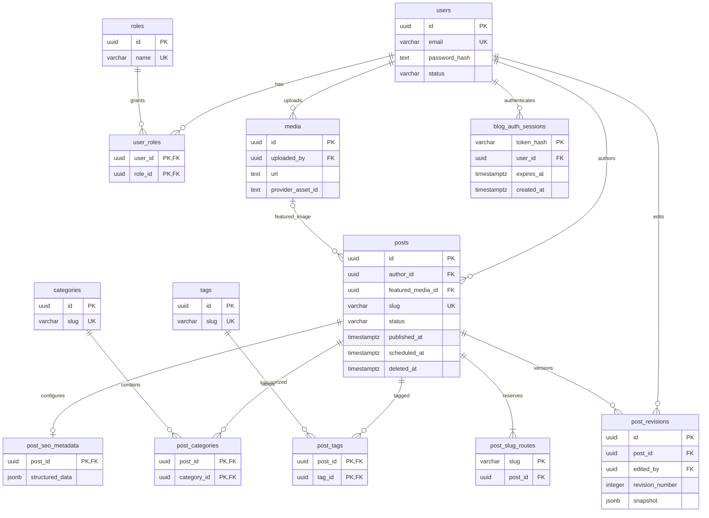

# Database blog SEO Artoku

## Analisis dan keputusan sebelum implementasi

Blog melayani `/blog/{slug}` dengan beban utama pembacaan artikel terpublikasi.
Database terpisah `artoku_blog` menjadi batas kepemilikan data, bukan sekadar
schema PostgreSQL lain dalam database keuangan. Instance PostgreSQL boleh sama
untuk MVP; database, kredensial, backup, dan riwayat Flyway tetap terpisah.
Tidak ada FK, FDW, dblink, atau akses tabel lintas database. Identitas pengguna
blog tidak sama dengan identitas pengguna Artoku walaupun alamat email sama.

Repo saat ini memakai Java 21 dan Spring Boot **4.1.1**, bukan Boot 3 dalam brief.
Migration SQL ini tidak bergantung pada versi Boot. Migration keuangan V1–V9
tetap pada `db/migration`; blog memakai `db/blog-migration` V1–V6. Jangan
menggabungkan kedua lokasi dalam satu instance Flyway.

MVP inti: users, roles, user_roles, posts, categories, tags, kedua junction,
post_seo_metadata, media, dan post_slug_routes. Visitor tracking menggunakan tool analitik eksternal tanpa tabel statistik lokal.
Revisi juga opsional untuk rilis awal; schema disiapkan agar tidak perlu merombak
artikel. Paket lengkap menjalankan keenam migration secara berurutan. Jangan
menghapus migration yang sudah diterapkan untuk menonaktifkan fitur.

Tidak ditambahkan permission matrix, event mentah, visitor profiles, folder media,
komentar, hierarki kategori, tabel related posts, TOC, atau graf internal link.
Tabel tersebut belum memberi manfaat yang sebanding dengan biaya pemeliharaan.

## Alternatif desain

SEO dalam posts mengurangi satu join dan cukup baik untuk blog kecil. Tabel
satu-ke-satu yang dipilih memisahkan konfigurasi SEO opsional dari konten dan
memudahkan penambahan field tanpa memperlebar tabel artikel. Detail publik memakai
LEFT JOIN sehingga artikel tanpa row SEO tetap tampil dengan fallback. PK post_id
mencegah lebih dari satu konfigurasi SEO per artikel. JSONB hanya untuk schema
markup dan snapshot revisi; field utama yang sering divalidasi tetap kolom biasa.

Satu role_id pada users lebih sederhana tetapi membatasi satu role per pengguna.
user_roles mendukung kombinasi role tanpa perubahan struktur. Tidak ada akun admin
atau password bawaan; provision akun pertama dengan hash password melalui proses
admin yang aman. Role belum otomatis menerapkan otorisasi API.

Featured image memakai FK media, bukan duplikasi URL pada posts. URL didapat lewat
join. Media inline direferensikan oleh HTML; tidak perlu junction untuk MVP.
Konsekuensinya penghapusan aset inline harus memeriksa konten/revisi di aplikasi.
Alt text pada media adalah default; konteks inline dapat memberikan alt berbeda,
termasuk string kosong untuk gambar dekoratif.

## ERD lengkap



ERD menampilkan key utama; seluruh kolom, default, constraint, dan indeks terdapat
dalam SQL migration, yang menjadi definisi schema lengkap.

## Tanggung jawab tabel dan integritas

| Tabel | Tanggung jawab |
|---|---|
| users | Akun pengelola blog, hash password, status, nama penulis |
| roles | ADMIN, EDITOR, AUTHOR; perlu migration untuk memperluas CHECK role |
| user_roles | Keanggotaan banyak role, PK gabungan mencegah duplikat |
| posts | Konten HTML, excerpt, penulis, jadwal, status, waktu baca, featured, soft delete |
| categories | Taksonomi utama datar dengan slug unik |
| tags | Label fleksibel dengan slug unik |
| post_categories | Banyak kategori per artikel |
| post_tags | Banyak tag per artikel |
| post_seo_metadata | Override metadata SEO opsional satu-ke-satu |
| media | Metadata file eksternal, dimensi, bytes, provider, pengunggah |
| post_revisions | Snapshot immutable yang ditulis aplikasi per revisi |
| blog_auth_sessions | Hash token sesi CMS, pengguna, waktu kedaluwarsa |
| post_slug_routes | Reservasi slug kini dan historis; dasar redirect 301 |

Entitas utama menggunakan UUID default gen_random_uuid(); baseline PostgreSQL 14+.
Junction memakai composite PK yang mencerminkan identitas alami.
Email unik case-insensitive melalui lower(email); aplikasi harus trim dan
normalisasi email secara konsisten. Slug lowercase ASCII bertanda hubung,
unik global per jenis konten; slug artikel tidak dipakai ulang setelah soft delete.
Nama kategori/tag boleh sama; slug adalah identitas publiknya.

CHECK menjaga enum status, timestamp publikasi wajib untuk PUBLISHED, angka positif,
dan bentuk dasar URL/JSON. Pemeriksaan URL penuh dan schema.org dilakukan aplikasi.
Timestamp memakai TIMESTAMPTZ. Trigger mengisi
updated_at pada UPDATE, termasuk SQL langsung; created_at memakai default.

FK penulis/pengunggah/editor dan kategori/tag menggunakan RESTRICT agar data yang
masih dipakai tidak terhapus. Gunakan status INACTIVE untuk menonaktifkan pengguna.
Data milik artikel memakai CASCADE hanya saat hard delete; soft delete tidak
menghapus revisi dan route. Media featured memakai RESTRICT agar
referensi tidak rusak. Purge permanen perlu kebijakan retensi eksplisit.

PK/UNIQUE menyediakan indeks identitas; FK lain diberi indeks sesuai arah lookup.
Junction punya indeks terbalik untuk filter taksonomi. Partial index feed mendukung
status PUBLISHED yang belum dihapus dan pagination menurut tanggal/id. Indeks
jadwal mendukung worker.
Tidak menambah indeks JSONB/full-text/featured sampai profil query membuktikan perlu.

## Publikasi dan SEO

Semua query publik wajib memfilter status PUBLISHED, deleted_at IS NULL, dan
published_at <= CURRENT_TIMESTAMP; filter ini juga berlaku untuk sitemap,
related posts dan RSS. Draft preview memerlukan autentikasi.
Scheduler memilih draft scheduled_at <= now() dengan row lock SKIP LOCKED,
lalu mengubah status, mengisi published_at, dan mengosongkan scheduled_at dalam
satu transaksi. Tanggal publikasi masa depan tidak otomatis mempublikasikan draft.

Canonical default `https://www.myartoku.com/blog/{slug}`; gunakan override hanya
bila diperlukan. Meta title fallback ke title, description ke excerpt, OG image
ke featured media. Batas panjang title/description adalah panduan editorial,
bukan hard limit SEO 60/160 karakter. Fokus keyword tidak membutuhkan indeks.
Generate BlogPosting JSON-LD dari data artikel/penulis/tanggal; JSONB untuk override
yang sudah divalidasi. Jangan keluarkan markup yang bertentangan dengan konten.
Robots boolean menghindari kombinasi index/noindex yang kontradiktif; fallback true.
Noindex berbeda dari status publikasi dan bukan mekanisme keamanan.

Slug baru otomatis masuk route lewat trigger. Slug historis dimiliki artikel yang
sama selamanya selama artikel belum dihapus permanen. Aplikasi membaca route,
memeriksa kelayakan publikasi, lalu mengirim 301 langsung ke slug saat ini atau
200 bila sama. Route tidak menyimpan target URL sehingga tidak membuat rantai
redirect atau open redirect. Batasi role runtime: jangan izinkan aplikasi mengubah
atau menghapus route secara langsung. Slug kategori/tag sebaiknya stabil di MVP;
redirect taksonomi dapat ditambahkan jika pengubahan URL tersebut diperlukan.

Sanitasi HTML sebelum penyimpanan/render; escape JSON-LD dan metadata pada output.
TOC dihasilkan dari heading HTML; waktu baca dihitung dari plain text pada save,
bukan query SQL. Related posts berbasis kesamaan kategori/tag; link internal tetap
di HTML hingga kebutuhan audit link membenarkan tabel tersendiri.

## Revisi dan analitik

Revisi bukan audit otomatis: service menyimpan snapshot berisi title, slug,
excerpt, content_html, SEO, featured_media_id, kategori/tag UUID, serta schema_version.
Lock row posts sebelum menghitung revision_number dan simpan perubahan+snapshot
dalam satu transaksi. Restore membuat revisi baru, memvalidasi FK dan reservasi
slug kembali; tidak menimpa sejarah. Snapshot JSONB dipilih agar snapshot lengkap
tidak memerlukan banyak junction historis; ia tidak memberi FK ke isi JSON.

Visitor tracking menggunakan tool eksternal pilihan pengelola. Database blog tidak
menyimpan page views, unique visitors, sesi, sumber trafik, atau counter kunjungan.
Artikel paling banyak dibaca dilaporkan oleh tool eksternal, bukan query PostgreSQL.
Integrasi script atau API tool eksternal belum ditambahkan pada perubahan schema ini.

Laporan jumlah artikel terbit per bulan tetap dihitung dari posts.published_at
karena merupakan data editorial, bukan statistik pengunjung. Query tersebut tidak
merekam histori seluruh transisi status publikasi.

## Provisioning dan menjalankan Flyway

CREATE DATABASE tidak boleh dijalankan dalam transaksi migration Flyway.
DBA/provisioning membuat role dan database terlebih dahulu, melalui psql terhubung
ke database administrasi (tanpa password hardcoded):

```sql
CREATE ROLE artoku_blog_owner LOGIN;
-- Atur password lewat secret manager atau psql \password artoku_blog_owner.
CREATE DATABASE artoku_blog OWNER artoku_blog_owner;
REVOKE CONNECT ON DATABASE artoku_blog FROM PUBLIC;
GRANT CONNECT ON DATABASE artoku_blog TO artoku_blog_owner;
```

Untuk produksi, pisahkan owner/migrator dari role runtime non-DDL. Jangan memberi
role keuangan hak akses blog atau sebaliknya; DBA tetap memiliki akses administratif.
Jalankan dari root repository menggunakan Flyway CLI yang mendukung PostgreSQL:

```bash
export FLYWAY_USER=artoku_blog_owner
# Inject FLYWAY_PASSWORD melalui secret manager/environment lokal.
flyway -configFiles=docs/blog-flyway.conf.example info
flyway -configFiles=docs/blog-flyway.conf.example migrate
flyway -configFiles=docs/blog-flyway.conf.example validate
```

Periksa host/database tujuan sebelum migrate. Kredensial blog tidak boleh mempunyai
akses database keuangan. Setiap database mempunyai flyway_schema_history sendiri;
nomor V1–V6 blog tidak berhubungan dengan nomor migration keuangan.

V1–V5 mendefinisikan konten CMS; V6 menambahkan blog_auth_sessions untuk
sesi login CMS. V1–V5 yang sudah diterapkan tidak diubah.

Runtime CMS sekarang tersedia sebagai modul opsional pada aplikasi yang sama.
Lihat [konfigurasi dan kontrak autentikasi CMS](blog-auth-api.md).
Datasource blog memakai bean non-default candidate sehingga datasource utama,
JPA keuangan, dan bean Flyway utama tetap dikelola auto-configuration.
Blog memakai JdbcTemplate dan TransactionTemplate dengan transaction manager lokal
khusus blog. Tidak ada entity blog yang masuk ke persistence unit JPA keuangan.
Flyway blog dijalankan dalam inisialisasi BlogStore dan bukan bean Flyway kedua.
Integrasi ini diuji dengan dua database terpisah. Pendekatan datasource tambahan
mengikuti [panduan Spring Boot](https://docs.spring.io/spring-boot/how-to/data-access.html).

Untuk pindah microservice, pindahkan migration ini dan dump/restore artoku_blog,
kemudian ubah routing dan kredensial layanan. Tidak perlu memisahkan tabel pengguna
keuangan karena tidak pernah ada relasi langsung. Event/API dapat dipakai untuk
integrasi masa depan dengan kontrak identitas yang eksplisit.

## Artefak dan referensi

- Schema lengkap: [V1–V6](../src/main/resources/db/blog-migration/).
- [Query publik, related posts, dan laporan publikasi](blog-queries.sql).
- [Konfigurasi Flyway CLI](blog-flyway.conf.example).
- [PostgreSQL constraints](https://www.postgresql.org/docs/18/ddl-constraints.html).
- [Flyway locations](https://documentation.red-gate.com/flyway/reference/configuration/flyway-namespace/flyway-locations-setting).
- [Flyway CLI](https://documentation.red-gate.com/flyway/reference/usage/command-line).
